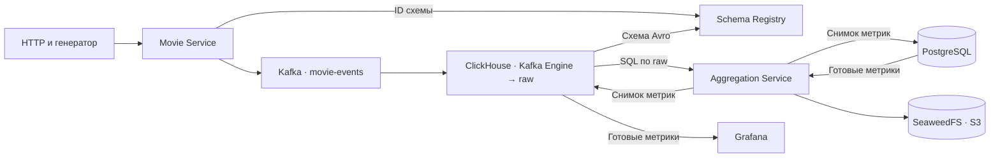

# Online Cinema

ДЗ5 по сервис-ориентированным архитектурам. Movie Service принимает события онлайн-кинотеатра. Kafka хранит поток, ClickHouse принимает и агрегирует события, PostgreSQL отдаёт готовые метрики, Grafana показывает их, а SeaweedFS хранит ежедневные выгрузки по API S3.



## Запуск

Из каталога проекта. Нужен Docker Compose. Для Colima с запущенным отдельным профилем ДЗ5 укажите его контекст в текущем терминале.

```sh
export DOCKER_CONTEXT=colima-hw5
make run
make test
```

В обычном Docker-контексте достаточно `docker compose up`. Рекомендуемый ресурс Colima — 3 CPU и 5 ГБ RAM. Старт создаёт topic, регистрирует Avro, применяет SQL и создаёт бакет. Одноразовый сервис `bootstrap` завершает работу с кодом 0. Grafana автоматически получает datasource и дашборд.

- Movie Service — [Swagger](http://localhost:8050/docs).
- Aggregation Service — [Swagger](http://localhost:8051/docs).
- Grafana — [Online Cinema Analytics](http://localhost:3050/d/online-cinema), демо-вход `admin` / `admin`.
- Schema Registry — [активная версия схемы](http://localhost:8081/subjects/movie-events-value/versions/latest).

`make stop` останавливает стенд с сохранением данных.

## Демонстрация

```sh
make demo
DAY=$(date -u -v-1d +%F)
curl -fsS -X POST "http://localhost:8051/recompute/$DAY"
curl -fsS -X POST "http://localhost:8051/export/$DAY"
```

Команда `date` выше для macOS. Можно вместо неё вписать дату вчерашнего дня по UTC. Демо создаёт несколько когорт за последние восемь завершённых суток. Агрегатор подхватит их в очередном цикле. В Grafana откройте Retention Cohort Heatmap, DAU и конверсию. Для одинарной публикации из файла:

```sh
curl -i http://localhost:8050/events --json @examples/view-started.json
```

В потоковом режиме `GENERATOR_INTERVAL_SECONDS=1 make run` продюсер генерирует новую синтетическую сессию примерно раз в секунду. Внутри сессии есть поиск и события просмотра в причинном порядке. Часть зрителей не досматривает, часть ставит лайк. `AGGREGATION_INTERVAL_SECONDS` задаёт интервал обработки. По умолчанию он равен 60 секундам.

## Архитектурные решения

- **Порядок и доставка.** [Avro v1](schemas/movie-event-v1.avsc) регистрируется как `movie-events-value` с совместимостью BACKWARD. Смена схемы требует следующей версии и проверки сопоставления полей в Kafka Engine. Ключ — `user_id`: поиск, просмотр и лайк одного пользователя сохраняют порядок записи в одной партиции. Перепубликация из HTTP сохраняет тот же `event_id`. Продюсер валидирует HTTP и Avro, ждёт `acks=all`, а librdkafka повторяет временные ошибки с экспоненциальной задержкой. Три брокера KRaft, три партиции, RF=3 и min ISR=2 позволяют писать при отказе одного брокера. Общий хост Colima остаётся общей точкой отказа.
- **Хранение событий.** Kafka Engine декодирует AvroConfluent через Registry. Материализованное представление перекладывает записи в ReplacingMergeTree с месячными партициями и сортировкой `(event_date, event_id)`. `FINAL` убирает повтор события до фонового merge. Повтор одного ID должен иметь прежний payload, в том числе ту же дату. `progress_seconds` хранится как целое для просмотра и как NULL для поиска и лайка.
- **Метрики UTC-дня.** DAU считает уникальных пользователей по всем типам. Среднее — по прогрессу завершённых просмотров. Топ считает начала просмотров, конверсия — отношение числа завершений к числу стартов за день. Пользователь входит в когорту в день первого `VIEW_STARTED`, возврат означает новое начало просмотра в день Dn. День когорты D0 равен 100%, дни без возвратов — 0%, будущие дни — NULL.
- **Пересчёт и экспорт.** ClickHouse материализует целый снимок под датой. PostgreSQL заменяет все строки даты в одной транзакции, включая состав топа. Планировщик пересчитывает восемь завершённых суток каждые 60 секунд, чтобы обновлять D1–D7. Ручной пересчёт подходит для более старых дат. Между двумя БД возможна временная разница при сбое записи, следующий пересчёт её устраняет. После успешного пересчёта ставится задача экспорта за вчера, а также обновляется архив когорты, для которой наступил D7. Каждый плановый экспорт ставится раз в UTC-день. Неудачная отправка остаётся в PostgreSQL до следующего запуска. Для каждой даты один ключ `s3://movie-analytics/daily/YYYY-MM-DD/aggregates.json`.

## Проверки по критериям

| Критерий | Реализация |
|---|---|
| 1. Контракт, версия и topic | [Схема Avro](schemas/movie-event-v1.avsc), [bootstrap](cinema/bootstrap.py) |
| 2. Продюсер и генератор | [HTTP, Kafka и подтверждение](cinema/producer.py), [генератор](cinema/generator.py) |
| 3. ClickHouse ingestion | [Kafka Engine, raw и Materialized View](sql/clickhouse.sql) |
| 4. Тест | `make test` проверяет все поля события через HTTP и ClickHouse. Отдельная историческая дата и случайные ID изолируют прогон |
| 5. Агрегация | [SQL-запросы](sql/), [планировщик и запись](cinema/metrics.py), [API ручного пересчёта](cinema/aggregation.py) |
| 6. Grafana | [Provisioning и дашборд](grafana/) |
| 7. S3 | [Экспорт и повторы](cinema/metrics.py), [таблицы состояния](sql/postgres.sql) |
| 8. Kafka HA | [Три брокера, Registry и health checks](compose.yaml) |

[Интеграционный тест](tests/integration.py) дополнительно сверяет вычисленные значения, повторный пересчёт, содержимое S3-объекта и запрос Grafana.
